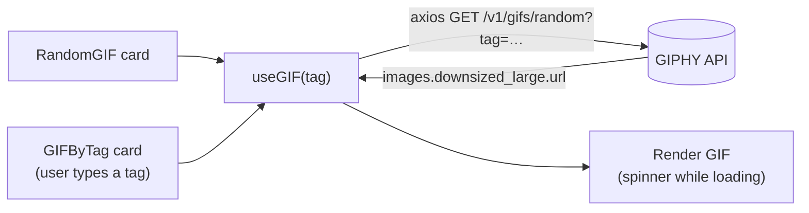

<div align="center">

# 🎞️ GIF Generator

**Need a GIF? Get a completely random one — or type a topic and get a random GIF about it. Powered by the GIPHY API.**

[](https://gif-generator-sand.vercel.app)


[Features](#-features) · [How it works](#-how-it-works) · [Getting Started](#-getting-started) · [Structure](#-project-structure)

</div>

---

## ✨ Features

| | Feature |
|---|---|
| 🎲 | **Random GIF** — one click, any GIF |
| 🏷️ | **GIF by tag** — type *cats*, *coding*, *dance*… and get a matching random GIF |
| ♻️ | **Reusable `useGIF` custom hook** shared by both cards |
| ⏳ | **Loading spinner** while a GIF is on its way |
| 🎨 | **Tailwind CSS** styling |

## 🔄 How it works



## 🚀 Getting Started

1. **Clone & install**
   ```bash
   git clone https://github.com/Shariq2003/GIF_Generator.git
   cd GIF_Generator
   npm install
   ```
2. **Get a free API key** from the [GIPHY Developer Dashboard](https://developers.giphy.com/dashboard/).
3. **Create a `.env`** file in the project root:
   ```env
   REACT_APP_GIPHY_API_KEY=your_giphy_api_key
   ```
4. **Run it**
   ```bash
   npm start          # http://localhost:3000
   ```

## 📁 Project Structure

<details>
<summary><b>Expand tree</b></summary>

```text
src/
├── components/
│   ├── Header.jsx
│   ├── RandomGIF.jsx
│   ├── GIFByTag.jsx
│   └── Spinner.jsx
├── hooks/
│   └── useGIF.jsx     # fetch logic shared by both cards
└── App.js
```

</details>

---

<div align="center">

Built by **[Shariq](https://github.com/Shariq2003)** · [LinkedIn](https://www.linkedin.com/in/shariq-sd)

⭐ If you like this project, consider giving it a star!

</div>
